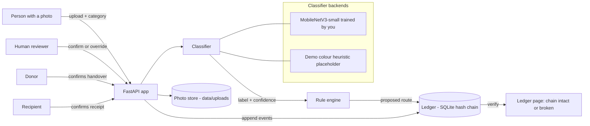
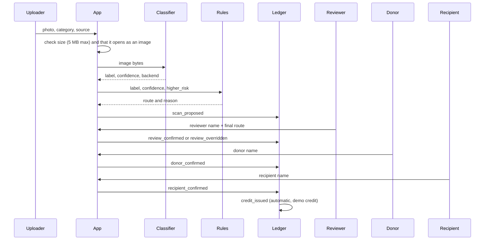
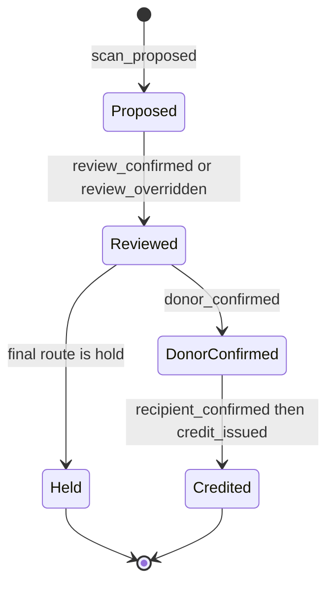

# FoodLoop architecture

How the prototype works, what each part is responsible for, and what is deliberately **not** built. Diagrams are Mermaid, which GitHub renders directly.

## 1. The idea in one line

A photo goes in, a model **proposes**, fixed rules **route**, a person **decides**, and every step is written to a tamper-evident log. The model never has the last word.

## 2. System overview



| Layer | Code | Responsibility |
|---|---|---|
| Web app | `foodloop/app.py`, `foodloop/templates/` | Upload, validation, review forms, batch list, ledger view, optional password |
| Classifier | `foodloop/classifier.py` | Returns `fresh` or `rotten` plus a confidence. Uses the trained model if `model/model.pt` exists, otherwise the demo heuristic. The backend name is stored with every result. |
| Rule engine | `foodloop/router.py` | Pure function. Same inputs always give the same route. No LLM, no randomness. |
| Ledger | `foodloop/ledger.py` | Append-only SQLite table, SHA-256 hash chain, and the rules for who may do what next |
| Training | `model/train.py`, `model/evaluate.py` | Transfer learning and held-out evaluation. Run offline, not part of the server. |

## 3. One batch, end to end



## 4. Routing rules

Evaluated in this order in `propose_route`:

| # | Condition | Route |
|---|---|---|
| 1 | Category is higher risk (`meat`, `dairy`, `ready_to_eat`) | hold |
| 2 | Confidence below `0.80` | hold |
| 3 | Label is `fresh` | people |
| 4 | Label is `rotten` | energy or compost |
| 5 | Anything else | hold |

Routes follow the order of the EPA Food Recovery Hierarchy: feed people, then animals, then industrial use and composting. The current rules never send food to "animals" automatically. That route exists only as a choice a human can make, because animal feed has its own safety rules this prototype does not model.

## 5. Ledger and credit rules



Enforced in code (and covered by `tests/test_router_ledger.py`):

- A named reviewer is required, and a batch can be reviewed only once.
- No handover steps on a batch that was not reviewed, or whose final route is **hold**.
- The donor confirms first. The recipient confirms second. They must be different names.
- A credit is written only after all of the above, and is labelled "demo credit, no monetary value".

### How the hash chain works

Each row stores `prev_hash` and its own `hash`, where

```
hash = SHA-256( prev_hash | timestamp | batch_id | event | payload )
```

The first row uses a fixed genesis value. `verify()` recomputes the whole chain. Editing any old row changes its hash, which no longer matches the next row's `prev_hash`, so the ledger page shows the chain as broken.

**What this does and does not prove:** it detects edits to past rows. It does not stop someone with write access to the database file from rebuilding the entire chain, and it cannot show that the real-world events happened. See `LIMITATIONS.md`.

## 6. Data model

One table, on purpose.

| Column | Meaning |
|---|---|
| `id` | Auto-increment row number |
| `ts` | UTC timestamp |
| `batch_id` | Short random id for the batch |
| `event` | `scan_proposed`, `review_confirmed`, `review_overridden`, `donor_confirmed`, `recipient_confirmed`, `credit_issued` |
| `payload` | JSON: label, confidence, backend, category, source, proposed route, reason, or the names and routes for later events |
| `prev_hash`, `hash` | The chain |

A batch's current state is **derived** by replaying its events, not stored separately. That means there is no second copy that can disagree with the log.

Photos are saved as JPEG thumbnails (up to 1024 px) in `data/uploads/<batch_id>.jpg`. They are not part of the hash chain.

## 7. HTTP endpoints

| Method and path | Purpose |
|---|---|
| `GET /` | Upload form |
| `POST /scan` | Validate, classify, propose route, redirect to the batch page |
| `GET /batch/{id}` | Result, review form, handover forms, audit trail |
| `POST /batch/{id}/review` | Human confirms or overrides the route |
| `POST /batch/{id}/confirm/{role}` | `role` is `donor` or `recipient` |
| `GET /batches` | List of batches and their status |
| `GET /ledger` | Full ledger and chain check |
| `GET /image/{id}` | The stored photo |
| `GET /health` | Liveness check |

If `FOODLOOP_USER` and `FOODLOOP_PASSWORD` are set, every route requires HTTP Basic login.

## 8. Design decisions and why

| Decision | Reason |
|---|---|
| Rules decide the route, the model only supplies a label | Rules can be read, tested and audited. A model's reasoning cannot. |
| Human review is mandatory, not optional | The model will be wrong sometimes. The dangerous mistake is calling rotten food fresh, so a person sits between the model and any handover. |
| Low confidence and risky categories go to hold | Doing nothing is the safe default when unsure. |
| Hash-chained SQLite, not a blockchain | The goal is tamper evidence for a small demo. A chain of hashes gives that with no network, no tokens and no cost. |
| State derived from events | One source of truth |
| Demo heuristic fallback, labelled | The workflow can be shown and tested without a trained model, without pretending to be one |
| Single process, SQLite, server-rendered pages | Easy to run on a laptop or a free server, easy to read, nothing to configure |

## 9. Trust boundaries

| Boundary | What is checked | What is not |
|---|---|---|
| Upload | Size limit, must open as an image, category must be known | No malware scanning, no check that the photo shows food |
| Names (reviewer, donor, recipient) | Required, and donor must differ from recipient | Free text. No identity check. Two people could type any two names. |
| Login | Optional single shared password | No users, roles or sessions |
| Ledger | Hash chain verification | Database file access is not restricted by the app |

## 10. Not built (future work)

These are ideas from the pitch, **not** features of this repo:

- Smell or gas sensors, and cameras at the field or storage site
- Tracking product from planting to harvest to storage
- Real user accounts, roles and verified identities
- Publishing the ledger head hash somewhere public so history cannot be quietly rebuilt
- Food-safety validation with a food-safety professional and real site photos
- Integration with an actual food-rescue organisation's intake process

## 11. Repo map

```
foodloop/
  foodloop/        app.py  router.py  ledger.py  classifier.py  templates/
  model/           train.py  evaluate.py   (model.pt is not committed)
  tests/           router, ledger, and full-app tests (12)
  deploy/          systemd unit, Apache config
  docs/            ARCHITECTURE.md  PITCH.md  BRAND.md  LIMITATIONS.md  DEPLOY.md
  data/            created at runtime, git-ignored
```
